<p></p>

# DDNS Agent

A self-hosted dynamic DNS updater with an integrated web panel. Go, SQLite and a small, locally bundled JavaScript interface. No browser CDNs, remote fonts or runtime UI framework.

[](https://github.com/Buffer379x/ddns-agent/releases)
[](https://github.com/Buffer379x/ddns-agent/actions/workflows/ci.yml)
[](LICENSE)

## What's new in v1.1.x

Use **v1.1.2** for the blue interface refinements, compact header controls, read-only overview and consistent form/search layouts. It includes the Vultr pagination and runtime security fixes from v1.1.1.

- Refreshed overview, searchable hostnames, activity, users, notification settings and recovery tools. Responsive layouts, keyboard-accessible native dialogs, light/dark/system themes and German/English translations.
- Independent IPv4 and IPv6 updates and error states. A failed family is retried without discarding the last successful address.
- Revocable browser sessions, trusted proxy configuration, mandatory bootstrap password changes and encrypted webhook destinations.
- Validated, transactional imports with a preview and mandatory pre-import backup. Password-protected portable exports work across instance encryption keys.
- Updated provider integrations, bounded responses and pagination, retention for database logs/IP history, and tests before publishing AMD64/ARM64 images.

See the [v1.1.2 UI review](docs/v1.1.2-review.md), [security and validation report](docs/v1.1.0-review.md), [upgrade instructions](docs/UPGRADE.md) and [release notes](docs/release-notes.md).

## Screenshots

Screenshots come from the running v1.1.2 app with synthetic hostnames, documentation-only IP addresses and placeholder credentials.

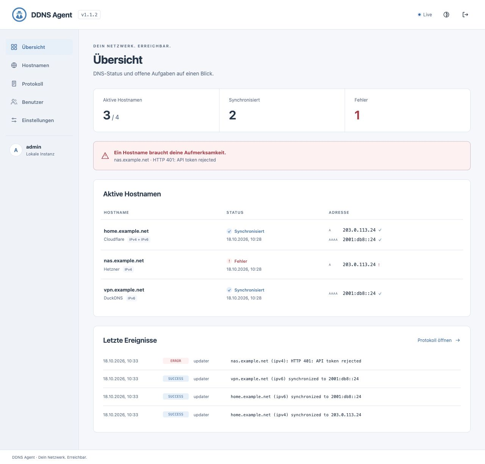

<details>
<summary>All pages, dark theme and mobile view</summary>

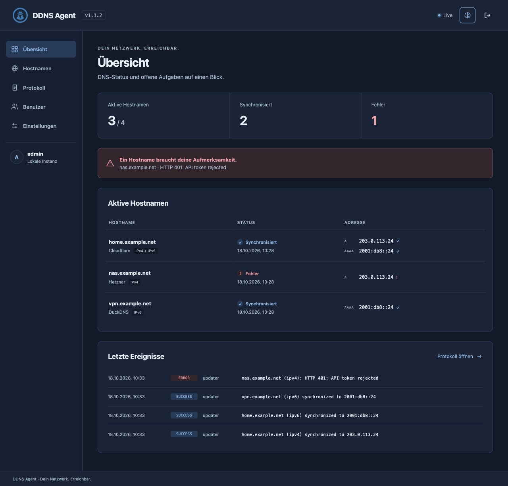
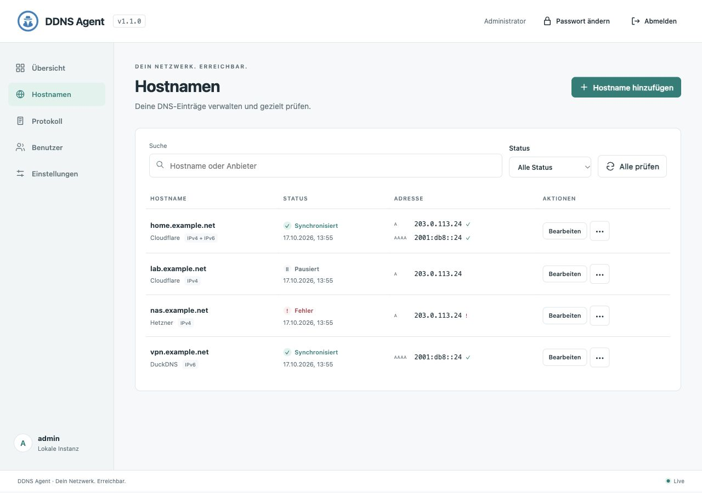
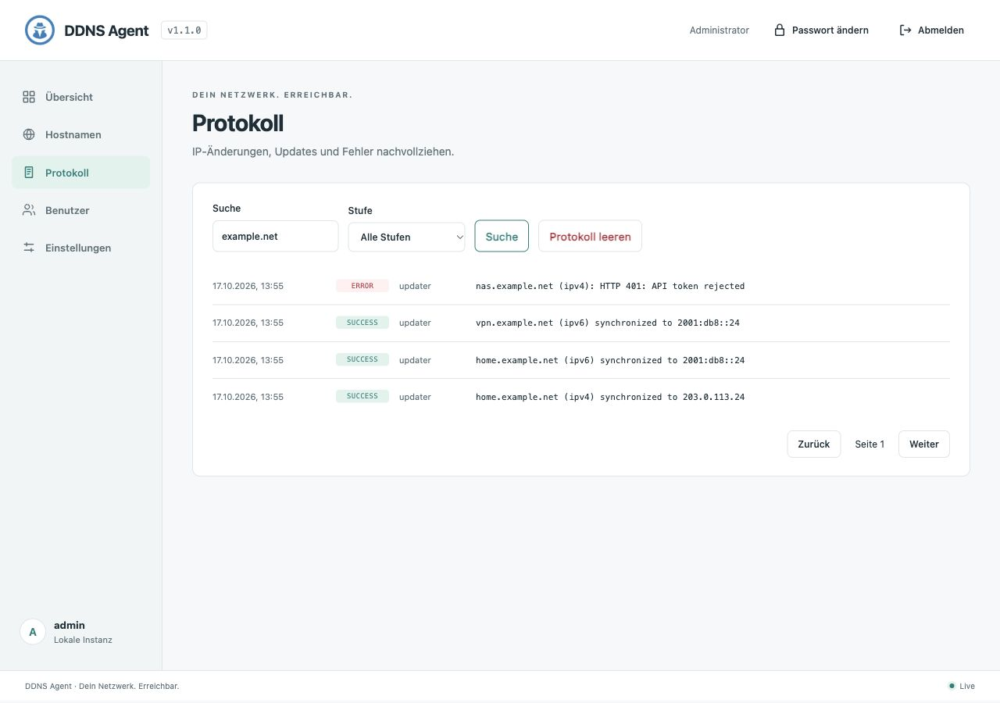
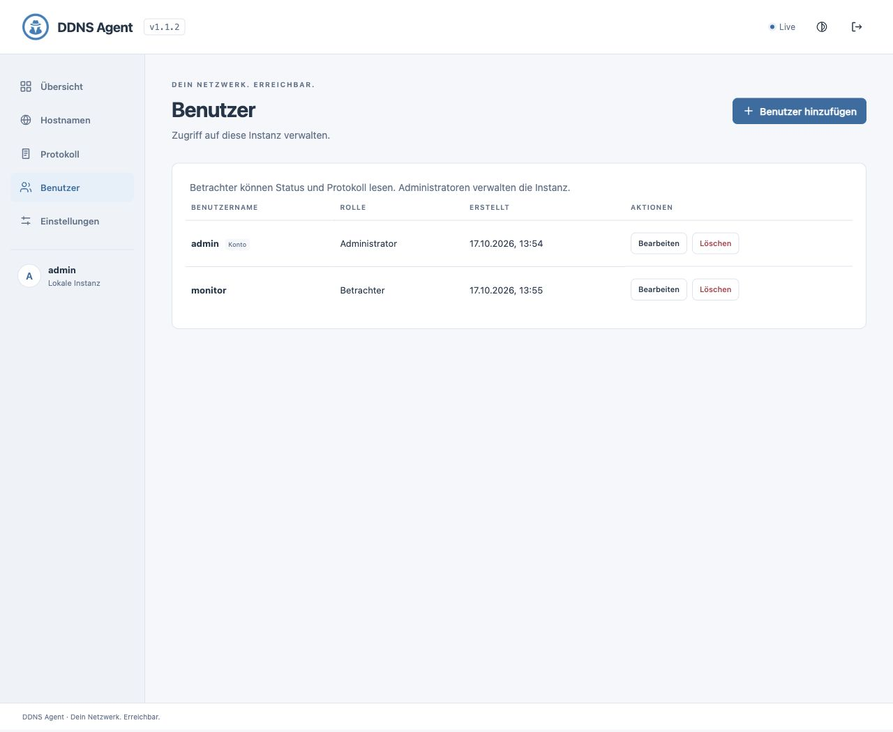
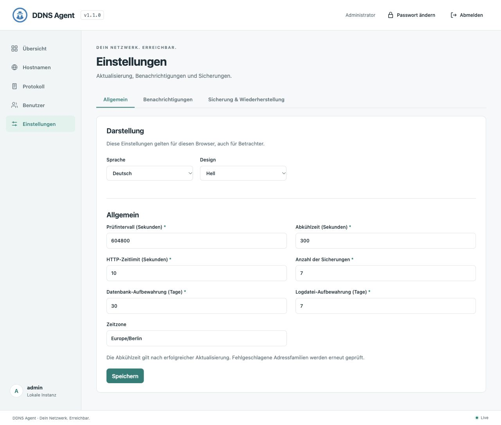
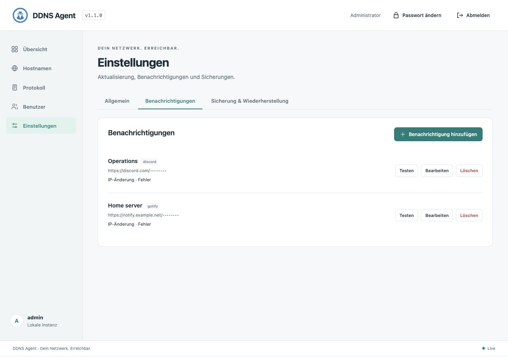
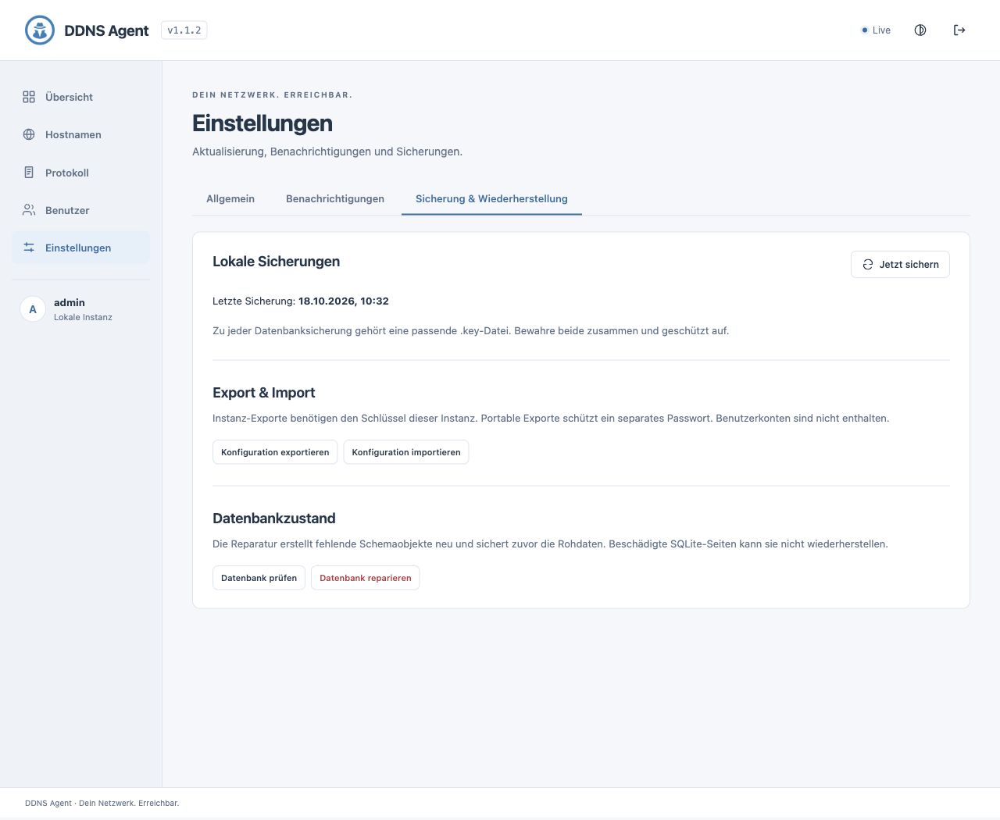
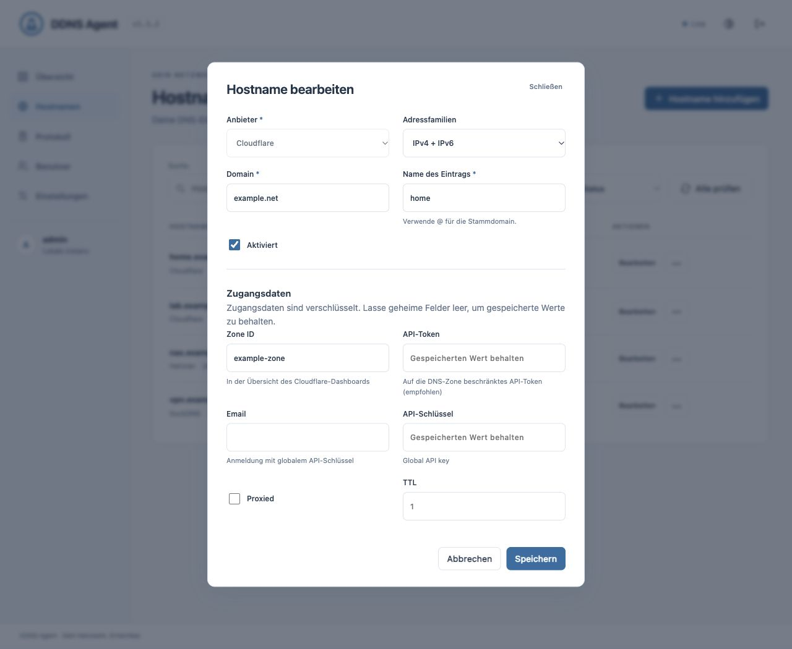
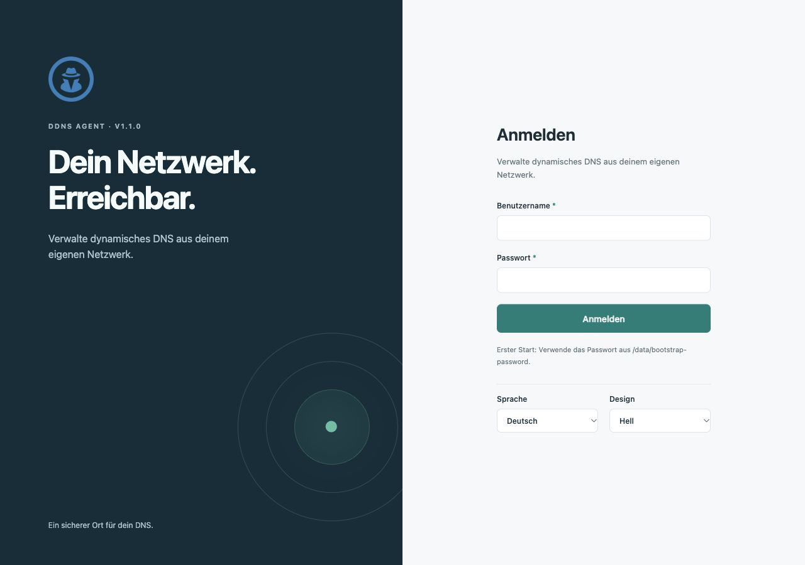
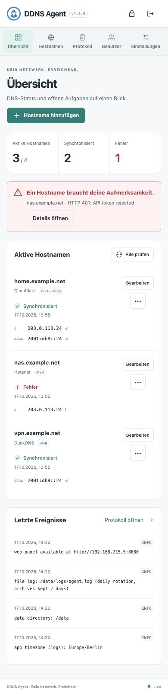

</details>

## Quick start

```yaml
services:
  ddns-agent:
    image: ghcr.io/buffer379x/ddns-agent:v1.1.2
    container_name: ddns-agent
    restart: unless-stopped
    ports:
      - "8080:8080"
    volumes:
      - ddns-data:/data
volumes:
  ddns-data:
```

```sh
docker compose up -d
docker exec ddns-agent cat /data/bootstrap-password
```

Open `http://localhost:8080`, sign in as `admin` with that instance's bootstrap password, and set a new password. The bootstrap file is removed after the required password change. Fresh installs have no shared default password. Existing `admin/admin` accounts must change their password after signing in.

The entrypoint migrates ownership of the dedicated data directory and runs the application as UID/GID **65532**. Override `DDNS_UID`/`DDNS_GID` if needed, or use Docker's `--user` and prepare volume permissions yourself. Only mount this app's own data directory at `/data`. Preserve its `.key` file when moving or upgrading an instance.

For Unraid, use [ddns-agent-unraid.xml](ddns-agent-unraid.xml). Review [the upgrade notes](docs/UPGRADE.md) before updating a 1.0.x volume.

## Configuration

Database settings take precedence after initial setup. Environment defaults initialize missing settings; change existing intervals under **Settings → General**. A new installation defaults to a five-minute check interval and cooldown.

| Variable | Default | Purpose |
|---|---|---|
| `DDNS_DATA_DIR` | `/data` | Database, keys, logs and backups; use a dedicated absolute directory |
| `DDNS_PORT` | `8080` | Listen port, also used by the built-in health check |
| `DDNS_UPDATE_INTERVAL` | `5m` | Initial interval, 1 minute–7 days |
| `DDNS_COOLDOWN` | `5m` | Initial cooldown after successful updates, 0–7 days |
| `DDNS_HTTP_TIMEOUT` | `10s` | Per-request timeout, 1 second–15 minutes |
| `DDNS_BACKUP_RETENTION` | `7` | Number of local database backup copies, 1–365 |
| `DDNS_LOG_RETENTION` | `7` | Archived file-log retention in days |
| `DDNS_TIMEZONE` / `TZ` | system | Initial log timezone; the UI's `app_timezone` setting takes precedence |
| `DDNS_TRUSTED_PROXIES` | empty | Comma-separated proxy CIDRs; forwarding headers are ignored by default |
| `DDNS_ADMIN_PASSWORD` | random | Optional initial password, 12–72 bytes; still requires a first-login change |
| `DDNS_JWT_SECRET` | persistent random key | Optional signing secret, at least 32 bytes; otherwise stored in `/data/.jwt-key` |
| `DDNS_ENCRYPTION_KEY` | persistent random key | Optional 64-character hex AES key; otherwise stored in `/data/.key` |
| `DDNS_UID` / `DDNS_GID` | `65532` | Container application identity |

Database log/IP-history retention defaults to **30 days** and is configurable in General settings. Daily backups include a matching `.db.key` file; both contain sensitive recovery material. Instance exports require the same encryption key. Portable exports use a separate password. Configuration exports contain settings, hostnames and notifications; they do **not** contain users or sessions.

Behind a reverse proxy, configure only that proxy's actual CIDR and forward `Host`, `X-Forwarded-For` and `X-Forwarded-Proto`. Preserve the browser's Origin header. SSE uses `/api/events`, with a 15-second heartbeat; disable proxy response buffering and allow long-lived streams. Browser mutations use an HttpOnly, SameSite=Strict session cookie and require a same-origin Origin header. API clients can continue using `Authorization: Bearer …`; query-string authentication is no longer accepted.

## Supported providers

**51 adapters:** Alibaba Cloud (Aliyun), ALL-INKL, ChangeIP, Cloudflare, Custom URL, DD24, DDNSS.de, deSEC, DigitalOcean, DNS-O-Matic, DNSPod, Domeneshop, DonDominio, Dreamhost, DuckDNS, Dyn, Dynu, dynv6, EasyDNS, FreeDNS, Gandi, Google Cloud DNS, GoDaddy, GoIP.de, Hurricane Electric, Hetzner, Infomaniak, INWX, IONOS, Linode, Loopia, LuaDNS, myaddr.tools, Namecheap, Name.com, NameSilo, Netcup, Njalla, No-IP, Now-DNS, OpenDNS, OVH, Porkbun, AWS Route 53, Selfhost.de, Servercow, spdyn.de, Strato, Variomedia, Vultr and ZoneEdit.

Namecheap supports IPv4 only. Hetzner requires a current Console/Cloud API token; old DNS Console tokens cannot be converted automatically. IONOS uses its DNS record API with explicit A/AAAA content. Njalla expects the key of a **Dynamic** DNS entry. Provider contracts are tested with simulated responses; live accounts and account-specific restrictions require a test zone.

## Development

Requirements: Go **1.27.2**, Node.js **24.19.0**, a C compiler for SQLite, and Docker for container checks.

```sh
cd web
npm ci --ignore-scripts
npm test
npm run build
cd ..
go test -race ./...
go vet ./...
CGO_ENABLED=1 go build -ldflags="-X main.version=$(cat VERSION)" -o ddns-agent ./cmd/ddns-agent
```

`web/dist` is generated and embedded in the binary. Source files and `node_modules` are never served. Use `npm exec prettier -- --write src build.mjs index.html package.json` from `web` to format frontend sources. CI also runs Staticcheck, govulncheck, npm audit and a container lifecycle smoke test.

To build locally with Docker:

```sh
docker compose up -d --build
```

Add a language by copying `web/lang/en.json`, translating its values and rebuilding. The UI discovers `web/lang/<locale>.json` through `/api/lang`. Keys are English source phrases; missing translations fall back to English. Language files from the 1.0.x interface need their keys updated for the refreshed interface.

The release workflow runs the quality gates, then publishes both Linux architectures and creates a matching GitHub tag/release when `VERSION` changes on `main`. Increment `VERSION` before a new stable release. The `beta` branch retains its separate container tag.

## Origin and license

This project grew out of ideas and patterns from [ddns-updater](https://github.com/qdm12/ddns-updater) by [qdm12](https://github.com/qdm12), with browser-based administration added for use on phones and tablets. Parts were developed with assistance from Claude Code and Codex. Licensed under [MIT](LICENSE).
